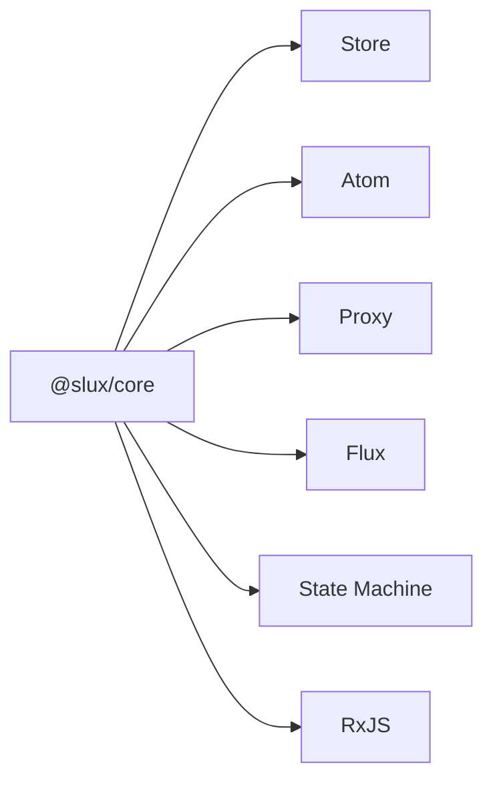

# 选择状态范式

六种范式都可与响应式核心协作。先看更新入口与状态粒度，再决定需要哪个包。

| 你想要的更新方式                 | 对应包 | 入口                                            |
| -------------------------------- | ------ | ----------------------------------------------- |
| 一组字段和 action 在同一个对象中 | Store  | [@slux/store](/packages/store/)                 |
| 独立状态单元、按读取关系派生     | Atom   | [@slux/atom](/packages/atom/)                   |
| 对对象属性直接赋值               | Proxy  | [@slux/proxy](/packages/proxy/)                 |
| reducer 处理 action 流           | Flux   | [@slux/flux](/packages/flux/)                   |
| 明确限制合法状态转换             | 状态机 | [@slux/state-machine](/packages/state-machine/) |
| 与现有 Observable 双向协作       | RxJS   | [@slux/rxjs](/packages/rxjs/)                   |

同一个应用可以按模块使用不同范式。如果要保存、撤销、同步或观测 Store 状态，再按需安装 [中间件](/packages/#store-中间件)。

