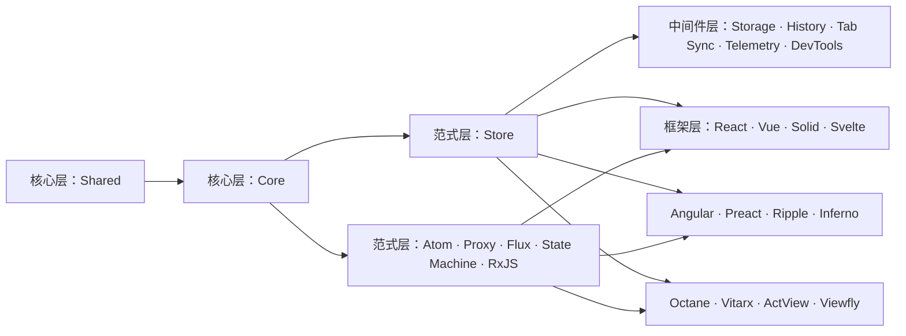

# 生态

slux 的包按用途分层。你可以只安装当前应用直接使用的包。

## 包关系图

图中列出当前 25 个已发布包。箭头表示主要的使用关系：核心支撑状态范式，Store 可接入中间件，框架绑定可读取各范式的状态源。`Shared` 提供多个包复用的工具；图中没有展开每一条包依赖。

插件层仍在规划中，目前没有独立发布包；现有的[自动导入接入](/packages/auto-import)使用各包公开的配置函数。

| 层级   | 包                                                                                                                                                                         | 解决的问题                   |
| ------ | -------------------------------------------------------------------------------------------------------------------------------------------------------------------------- | ---------------------------- |
| 核心   | [Core](/packages/core/)、[Shared](/packages/shared/)                                                                                                                       | 响应式原语与共享工具         |
| 范式   | [Store](/packages/store/)、[Atom](/packages/atom/)、[Proxy](/packages/proxy/)、[Flux](/packages/flux/)、[State Machine](/packages/state-machine/)、[RxJS](/packages/rxjs/) | 组织状态与更新流程           |
| 中间件 | [Storage](/packages/storage/)、[History](/packages/history/)、[Tab Sync](/packages/tab-sync/)、[Telemetry](/packages/telemetry/)、[DevTools](/packages/devtools/)          | 扩展 Store 的行为            |
| 框架   | [React](/packages/react/)、[Vue](/packages/vue/)、[Solid](/packages/solid/)、[Svelte](/packages/svelte/)、[Angular](/packages/angular/) 等                                 | 将状态接入组件生命周期与渲染 |

[包总览](/packages/)列出各入口。各包的演示示例来自仓库 `examples/` 中对应的独立项目。
